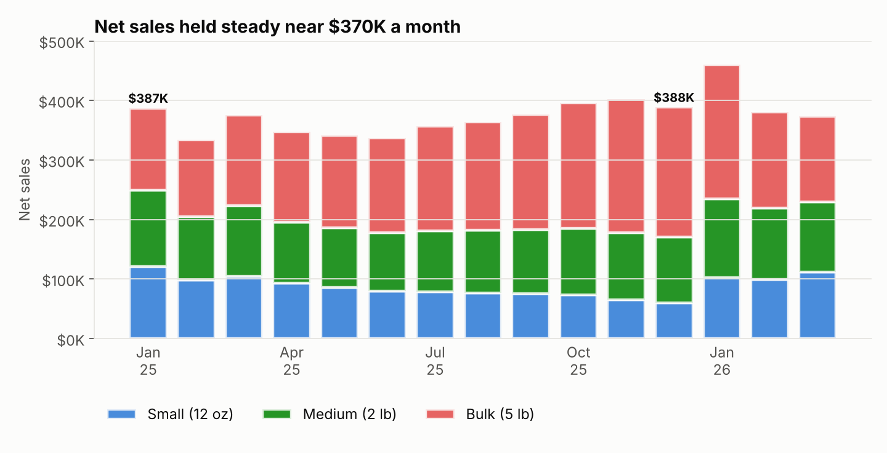
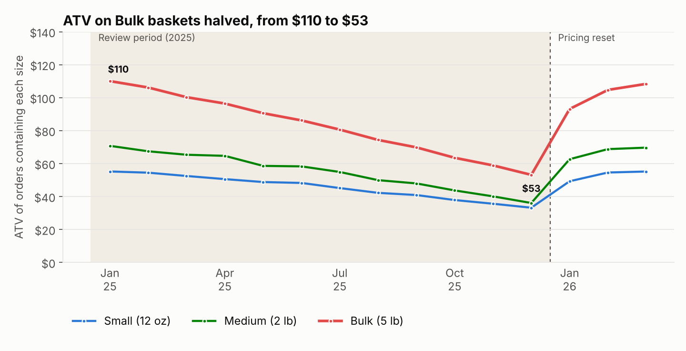
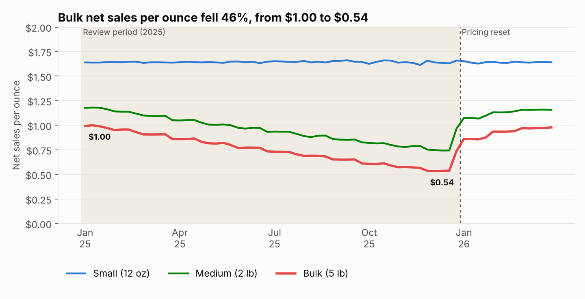
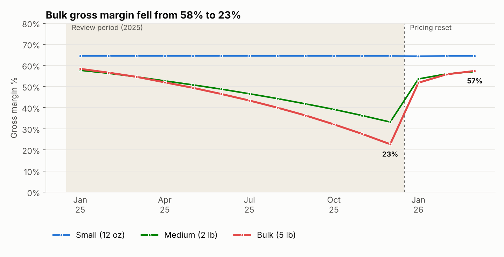
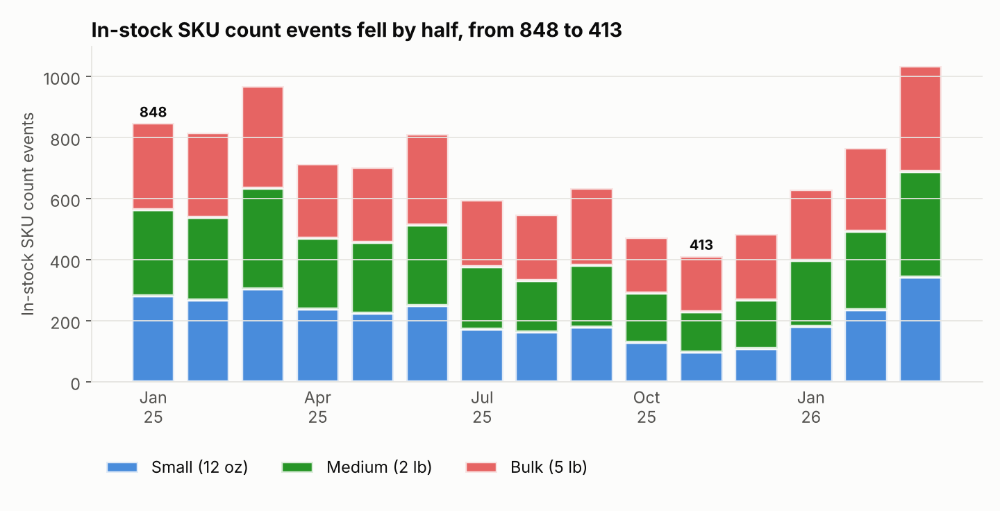
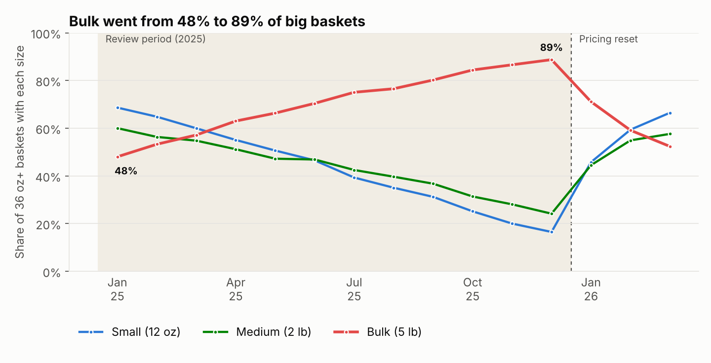

# Grounds for Concern
### When more units meant less profit: a coffee sizing and pricing EDA

> Ridgeline Roasters is a fictional 6-store specialty coffee retailer. The dataset is generated in this repo, but it's modeled on a real pricing and assortment analysis I led in a regulated retail category, and it reproduces the same pattern. A **unit** is one bag sold, whatever its size: Small (12 oz), Medium (2 lb) or Bulk (5 lb).

📄 Want the long version? **[Read the full report](https://docs.google.com/document/d/1lU5B2a1CKG4U8uVeBsMaXXyvfq0pTHoA6peX7-m9_Yk/edit?usp=sharing)** for every chart, store-level SKU snapshots and the full reasoning.



---

## Executive summary

Ridgeline's coffee category had a puzzling year. **Units sold climbed 13%** while **revenue stayed flat** and **average transaction value fell 37%**. Leadership needed to know whether this was a demand problem, a pricing problem, or something else.

It was pricing and assortment. Inventory shifted toward Bulk bags while smaller sizes went out of stock, and Bulk was discounted harder every month. Customers learned to buy the cheapest cost-per-ounce option, which cannibalized higher-margin Small and Medium sales. **Bulk gross margin fell from 58% to 23%**, and **gross margin dollars dropped 46%**, even though the registers looked busy.

| Jan → Dec 2025 | |
|---|---|
| Units sold | **+13%** (11.3K → 12.8K) |
| Net sales | **flat** ($387K → $388K a month) |
| Average transaction value | **−37%** ($60 → $38) |
| Gross margin dollars | **−46%** ($232K → $125K a month) |
| Bulk gross margin | **58% → 23%** |
| In-stock SKUs per store snapshot | **−51%** (213 → 104) |

---

## The business problem

On the surface the category looked healthy, because units were moving. Underneath, every bag was earning less: ATV slid month after month, and the biggest format was quietly losing most of its margin. Leadership had no view into *why*, and needed a clear diagnosis before the next planning cycle.



---

## My approach

1. **Look past units.** I tracked net sales, ATV and gross margin alongside unit volume to see whether growth was real.
2. **Split everything by size.** Small, Medium and Bulk each got their own margin, discount and price trend, to find where value was leaking.
3. **Price by the ounce.** Net sales per ounce compares sizes fairly, so it shows when one size undercuts the others.
4. **Check the shelf.** Weekly inventory snapshots show how many SKUs customers could actually buy.
5. **Watch what customers chose.** In big baskets (36 oz or more), which size did people reach for?

---

## What the data revealed

**1. Bulk was priced and discounted into a race to the bottom.**
Bulk's discount rate climbed from 1% to 29%, on top of a 25% list-price cut. Net sales per ounce on Bulk fell **46%, from $1.00 to $0.54**, about a third of Small's $1.64.



**2. Margin went with it.**
Bulk gross margin fell from **58% to 23%** by December. Medium followed it down, while Small held at 64% all year.



**3. The shelf thinned out, and the smallest sizes went first.**
In-stock SKU count events fell by half (848 → 413 a month). By December, one store had **zero** Small SKUs in stock.



**4. Customers traded down, and it wasn't new demand.**
Among baskets of 36 oz or more, the share that included a Bulk bag went from **48% to 89%**. Customers weren't buying more coffee. They were buying the cheapest ounce available, which cannibalized Small and Medium.



**The result:** rising units were masking serious margin erosion, a pattern that would have kept compounding without intervention.

---

## Recommendations

| Goal | Action | Estimated impact |
|---|---|---|
| Get Bulk back to **$0.90–$1.00 net per oz** (from $0.54) | **Pricing overhaul:** reverse the 25% list cut and set a **$0.90/oz net floor** no promo can break | Up to **$168K a month** at December volumes (upper bound). The reset lifted Bulk margin from 23% back to **57%** |
| Keep Bulk and Medium discounts **at or below 10%** (from 29% and 28%) | **Discount cap** by size tier, with no promo stacking | Recovers **~$334K**, or **7.6% of 2025 net sales** |
| Keep **at least 10 of 12 SKUs** per size in stock at every store (from 4–7) | **Inventory floor** by size; protect high-margin demand first in planning | ATV back from **$38 to $60**, gross margin from **$125K to $222K a month** (+77%) |

---

## Impact

The dataset models the reset taking effect in Q1 2026. By March:

- **ATV recovered to $60** (from $38 in December).
- **Bulk margin recovered to 57%**, and blended margin to 59% (from 32%).
- **Gross margin dollars rose 77%**, to $222K a month.
- **In-stock SKUs were back to about 35 per store**, and Bulk's share of big baskets fell back to 52%.

The bigger shift was in how the business measured health: from **units sold** to **profit per unit and per ounce**.

---

## How it's built

```
grounds-for-concern/
├── src/generate_data.py   # seeded synthetic data: stores, SKUs, ~165k order lines, weekly inventory
├── src/load_db.py         # loads the CSVs into SQLite and builds the views
├── sql/eda_queries.sql    # every report metric as a SQL view (ports to Snowflake or Postgres)
├── src/eda.py             # renders the report charts from those views
└── charts/                # chart PNGs used here and in the full report
```

```bash
pip install -r requirements.txt
python src/generate_data.py   # ~2 min, seeded so results reproduce
python src/eda.py             # builds the DB, renders the charts, prints headline numbers
```

**Tools:** SQL, Python (pandas, NumPy, matplotlib)
**Key metrics:** net sales per unit and per ounce, gross margin by size, discount rate, SKU availability, ATV, basket composition
