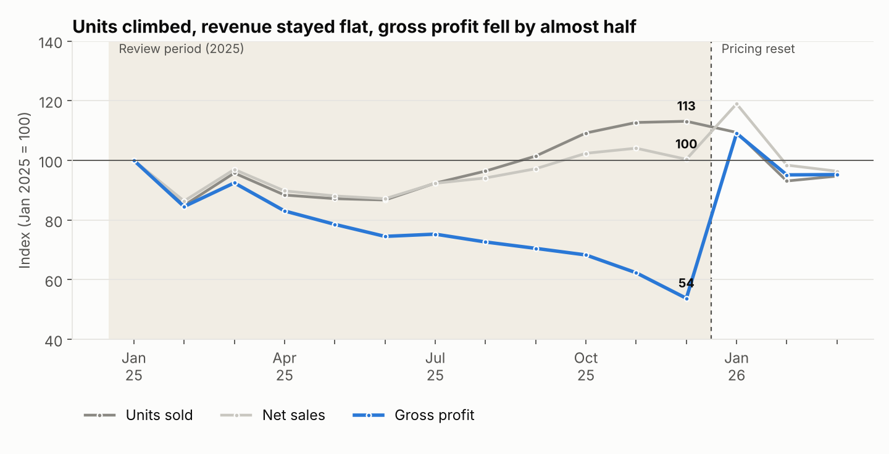
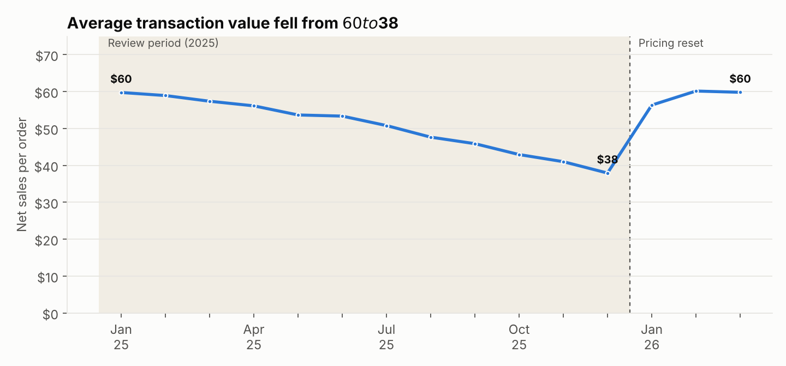
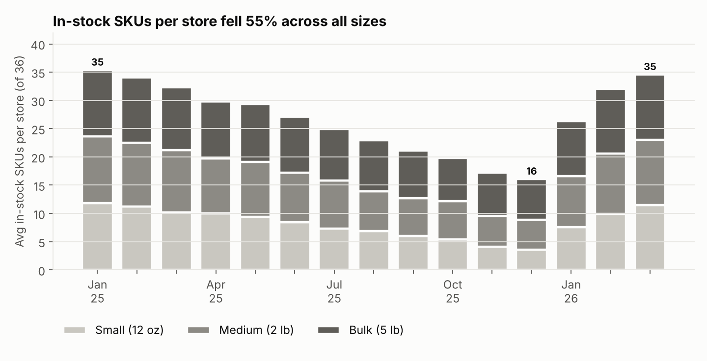
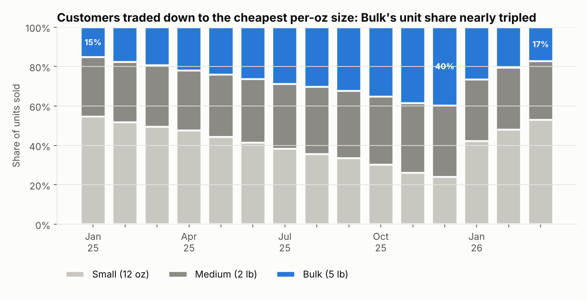
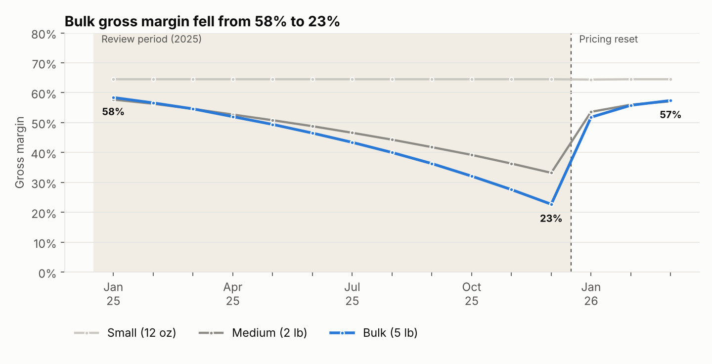
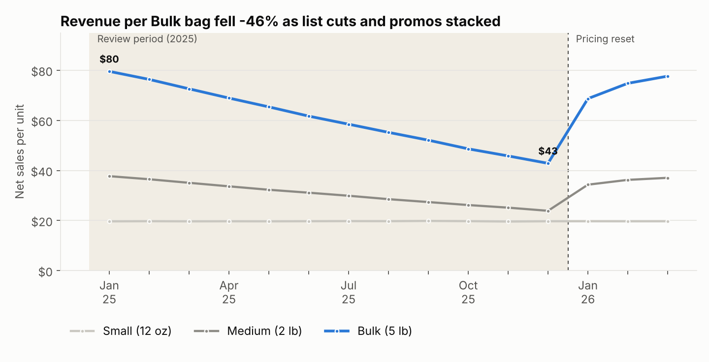

# Grounds for Concern
### Regional Coffee Assortment & Pricing Impact Analysis

> **Synthetic data.** Ridgeline Roasters is a fictional 6-store specialty coffee retailer. The dataset is generated in this repo, but it is modeled on a real pricing and assortment analysis I led in a regulated retail category, and it reproduces the same pattern. A **unit** is one item sold: a 12 oz bag and a 5 lb bag each count as one unit.



---

## Executive Summary

A regional specialty coffee retailer was experiencing a puzzling pattern: unit sales were climbing steadily while revenue remained flat and average transaction value declined sharply over the course of a year. Leadership needed to understand whether this was a demand problem, a pricing problem, or something else entirely.

I conducted an end-to-end pricing and assortment analysis examining net sales, gross margin, discount rates, net sales per unit and net sales per ounce across three product size tiers: **Small (12 oz)**, **Medium (2 lb)** and **Bulk (5 lb)**. The analysis revealed that a shift in inventory toward larger-format products had constrained customer choice and inadvertently trained customers to purchase the lowest cost-per-ounce option, cannibalizing higher-margin smaller sizes. Gross margin on the largest format had fallen from **58% to as low as 23%** over the review period, driven by a combination of aggressive discounting and underpriced inventory. Meanwhile, SKU availability across all sizes had declined by **55%**, limiting the customer's ability to trade up or diversify their basket.

My recommendations focused on three areas: resetting pricing strategy using net sales per unit as the primary profitability metric rather than units sold, capping discounts on large-format products to prevent margin erosion, and rebalancing inventory allocation to protect high-margin demand regardless of size. This analysis directly informed the pricing and planning team's strategy for the following quarter.

| Metric (Jan to Dec 2025) | Change |
|---|---|
| Units sold | **+13%** |
| Net sales | **flat (0%)** |
| Average transaction value | $59.76 → $37.93 (**−37%**) |
| Gross profit | **−46%** |
| Bulk gross margin | **58% → 23%** |
| Net sales per Bulk unit | $79.57 → $42.85 (**−46%**) |
| In-stock SKUs per store, all sizes | 35.4 → 16.1 (**−55%**) |

---

## The Business Problem

On the surface, the business looked healthy: units were moving. But revenue told a different story. Average transaction value was declining month over month, and gross margin on the category's largest format had quietly eroded to levels that threatened the business's profitability. Leadership lacked visibility into *why*, and needed a framework to diagnose the root cause and course correct before the next planning cycle.



---

## My Approach

I conducted an end-to-end pricing and assortment analysis across three product size tiers, examining:

- **Net sales**: to understand revenue trends beyond unit volume
- **Gross margin by size tier**: to identify where profitability was eroding
- **Discount rates**: to measure the impact of promotional activity on margin
- **Net sales per unit**: as the primary profitability lens, replacing units sold as the north star metric
- **SKU availability**: to assess whether assortment constraints were shaping customer behavior

The goal was to move from "units are up, revenue is flat" to a clear, data-backed explanation of the underlying dynamic, and a set of actionable recommendations for the pricing and planning team.

---

## What the Data Revealed

The analysis uncovered a compounding problem driven by three interconnected factors.

**1. Inventory shift toward larger formats constrained customer choice**

A shift in inventory toward larger-format products had reduced the availability of smaller, higher-margin sizes. SKU availability across all sizes declined by 55% over the review period, from about 35 to 16 in-stock SKUs per store, limiting the customer's ability to trade up or diversify their basket. Small was hit hardest, falling to about 4 of 12 SKUs in stock.



**2. Customers were trained to optimize for cost-per-ounce**

With smaller sizes less available and larger formats heavily discounted, customers naturally gravitated toward the lowest cost-per-ounce option. By December, Bulk sold for $0.54 per ounce against $1.64 for Small, and Bulk's share of units sold went from 15% to 40%. This behavior shift was not a demand problem. It was a pricing and assortment problem that the business had inadvertently created.



**3. Aggressive discounting on large formats destroyed margin**

Gross margin on the largest format fell from **58% to as low as 23%** over the review period, driven by a combination of aggressive discounting (Bulk discount rate went from 1% to 29%) and underpriced inventory. Net sales per Bulk unit fell 46% and per Medium unit 37%. Meanwhile, the cannibalization of higher-margin smaller sizes meant the business was selling more units at lower profitability across the board.





The result: rising unit sales masking significant margin erosion, a pattern that would have continued to compound without intervention.

---

## Recommendations

My recommendations focused on three areas:

**1. Reset the pricing strategy using net sales per unit as the primary profitability metric**
Units sold is a vanity metric when margin is eroding. Net sales per unit, not volume, should be the north star for evaluating pricing decisions across size tiers.

**2. Cap discounts on large-format products**
Discounting on the largest format was the single biggest driver of margin erosion. Implementing discount caps by size tier would protect margin without sacrificing competitive positioning.

**3. Rebalance inventory allocation to protect high-margin demand**
Restoring SKU availability across smaller sizes would give customers the choice to trade up, recovering margin from customers who would purchase higher-margin products if they were available.

---

## Impact

This analysis directly informed the pricing and planning team's strategy for the following quarter. The findings reframed how leadership assessed business health, shifting the conversation from unit volume to profitability per unit, and provided a clear, data-backed roadmap for recovering margin without sacrificing customer demand.

The dataset models the reset taking effect in Q1 2026. By March, average transaction value was back to $59.81, Bulk margin recovered to 57%, blended margin returned to 59% (from 32% in December), and in-stock SKUs were back to about 35 per store.

---

## Tools & Methods

- **SQL**: data extraction and transformation across inventory, transaction and discount data (SQLite here; the views port directly to Snowflake or Postgres)
- **Python**: data generation, statistical analysis and trend modeling across size tiers (pandas, NumPy, matplotlib)
- **Key metrics:** net sales per unit, gross margin by tier, discount rate, SKU availability, unit volume, average transaction value

### Repo layout

```
grounds-for-concern/
├── data/                  # generated CSVs + ridgeline.db (SQLite), not committed
├── sql/eda_queries.sql    # monthly, by-tier, in-stock and mix-shift queries
├── src/
│   ├── generate_data.py   # builds the synthetic dataset (seeded, reproducible)
│   ├── load_db.py         # loads CSVs into SQLite and creates the EDA views
│   └── eda.py             # runs the analysis, renders charts, prints headline numbers
└── charts/                # PNG outputs used in this README
```

### Data model

| Table | Grain | Key columns |
|---|---|---|
| `stores` | store | store_id, region, traffic_index |
| `products` | SKU (12 origins × 3 sizes) | sku_id, size_oz, size_tier, base_list_price, unit_cost |
| `transactions` | order line (~165k rows) | order_id, order_date, store_id, sku_id, qty, gross_sales, discount_amt, net_sales, cogs |
| `inventory_snapshots` | store × SKU × week | week_start, on_hand_units |

### Run it

```bash
pip install -r requirements.txt
python src/generate_data.py   # ~2 min, seeded so results are reproducible
python src/eda.py             # builds the DB, renders charts, prints the numbers above
```
