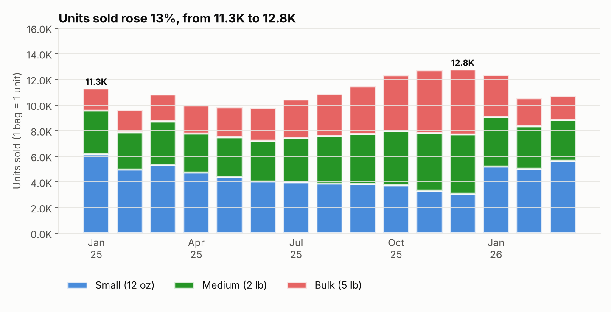
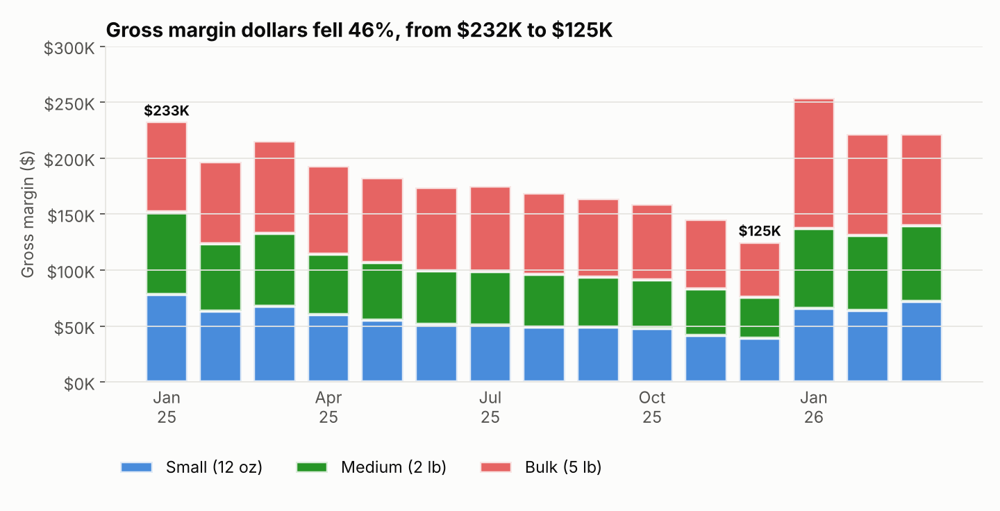
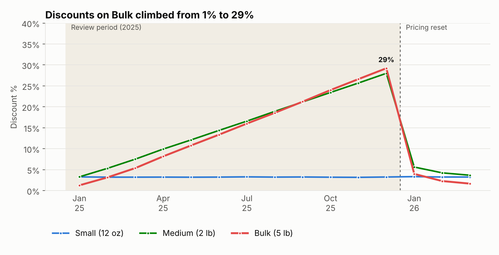

# Grounds for Concern
### Ridgeline Coffee Sizing Impact Report

> **Synthetic data.** Ridgeline Roasters is a fictional 6-store specialty coffee retailer. The dataset is generated in this repo, but it is modeled on a real sizing and pricing analysis I led in a regulated retail category, and it reproduces the same pattern. A **unit** is one item sold: a 12 oz bag and a 5 lb bag each count as one unit.

## Objective

Has there been a change in Ridgeline's whole-bean coffee assortment for bag sizing, and if so, what has been the impact on business performance?

## Methodology

This analysis evaluates customer transactions for *2025* (with Q1 2026 shown after the pricing reset) and includes the following:

- Trends across net sales, ATV, and units sold.
- Gross margin and discount impacts across assorted sizes: Small (12 oz), Medium (2 lb) and Bulk (5 lb).
- A review of net sales per total ounces sold to assess profitability trends across assorted sizes.

## Conclusion

**Summary:** Ridgeline's coffee category is suffering from a serious value leakage driven by underpriced Bulk bags, increased discounting and a shift in product inventory, which has shifted customer behavior in a way that inflates units sold but erodes margin and ATV.

**Recommendations**

| # | Goal | Action | Estimated impact |
|---|---|---|---|
| 1 | Bring Bulk back to **$0.90 to $1.00 net per ounce** (from $0.54 in December) | **Pricing overhaul:** reverse the 25% Bulk list-price cut and set a **$0.90/oz net floor** that no promo can break; track pricing by net sales per ounce, not units | Up to **$168K a month** of Bulk revenue at December volumes (upper bound, before any volume loss). The Q1 2026 reset reached $0.97/oz and lifted Bulk margin from 23% back to **57%** |
| 2 | Keep Bulk and Medium discounts **at or below 10%** (from 29% and 28%) | **Discount cap:** cap promo depth by size tier and block stacking on Bulk and Medium | Recovers **~$334K** of 2025 discounting, **7.6% of annual net sales** (13.7% of second-half net sales) |
| 3 | Keep at least **10 of 12 SKUs per size in stock per store** (from 4 to 7 in December) | **Inventory rebalance:** enforce minimum availability thresholds by size and protect high-margin demand first in production planning | After the reset: Small units **+84%** (3.1K to 5.7K a month), ATV **$38 to $60 (+58%)**, gross margin **$125K to $222K a month (+77%)** |

**Condensed reasoning notes**

- Steady net sales alongside increased units sold and eroding ATV signal the need to review margin and discount trends. *(Section 1)*
- The decline in gross margin and rise in discount percentages highlight the importance of reassessing dollar returns for each size. *(Section 2)*
- Net sales per ounce fell for Medium and Bulk, with Bulk showing the sharpest drop: 46% this year. *(Section 3)*
- SKU availability declined sharply across all sizes, pushing customers toward Bulk and cannibalizing Small and Medium. *(Section 4)*

---

## Review of Results

### 1. Steady Net Sales and Increased Units Sold Signal Trouble Ahead

- Monthly net sales averaged about **$367K** in 2025 and stayed flat: **$387K in January vs $388K in December**.
- Units sold rose from **11.3K to 12.8K (+13%)**, and Bulk net sales grew **58%** ($137K to $217K a month), signaling a decline in return per dollar.
- Combined ATV fell **37%** ($60 to $38). ATV on orders containing a Bulk bag fell **52%** ($110 to $53).





### 2. Gross Margin % Took a Hit Until the Reset

- Gross margin dollars fell **46%**, from $232K in January to $125K in December. Bulk fell from $80K to $49K (39%) and Medium from $74K to $37K (51%).
- Bulk gross margin fell from **58% to as low as 23%** in December, recovering to 57% only after the reset.
- Small discounts held near 3%. Bulk discounts climbed from 1% to **29%**, with Medium close behind at 28%.





### 3. Net Sales per Ounce Sold Signals Pricing Strategy Review

- Bulk net sales per ounce fell from **$1.00 to $0.54, a 46% drop**. Small held near $1.64, so by December Bulk sold for a third of Small's per-ounce price.


### 4. Impact of Limited Assortment on Customer Behavior

- **In-stock SKU count events** (SKUs in stock per store per weekly snapshot) fell by half, from **848** in January to **413** in November.
- Snapshot comparison: total in-stock SKUs dropped **51%**, from 213 (January 6) to 104 (December 8). Bulk's share rose from 34% to 38% while Small's fell from 33% to 28%.
- Among baskets with **36 oz or more** of coffee, the share that included a Bulk bag climbed from **48% to 89%**: customers opted for the best value through lower $ per ounce, deeper discounts and limited availability. This is cannibalization of Small and Medium.


| Snapshot | Small (12 oz) | Medium (2 lb) | Bulk (5 lb) | Total |
|---|---|---|---|---|
| January 6, 2025 | 71 | 70 | 72 | 213 |
| December 8, 2025 | 29 | 35 | 40 | 104 |

---

## Repo layout

```
grounds-for-concern/
├── data/                  # generated CSVs + ridgeline.db (SQLite), not committed
├── sql/eda_queries.sql    # monthly, by-size, in-stock and mix-shift queries
├── src/
│   ├── generate_data.py   # builds the synthetic dataset (seeded, reproducible)
│   ├── load_db.py         # loads CSVs into SQLite and creates the EDA views
│   └── eda.py             # renders the report charts and prints headline numbers
└── charts/                # PNG outputs used in this README
```

## Run it

```bash
pip install -r requirements.txt
python src/generate_data.py   # ~2 min, seeded so results are reproducible
python src/eda.py             # builds the DB, renders charts, prints headline numbers
```

## Tools & methods

- **SQL** (SQLite; the views port directly to Snowflake or Postgres) for extraction and metric logic
- **Python** (pandas, NumPy, matplotlib) for data generation, analysis and charts
- **Key metrics:** net sales per unit and per ounce, gross margin by size, discount rate, SKU availability, ATV, basket composition
