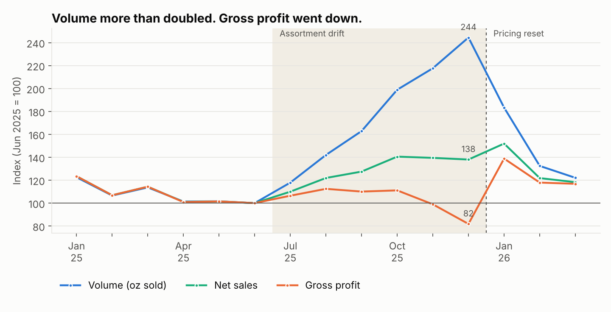
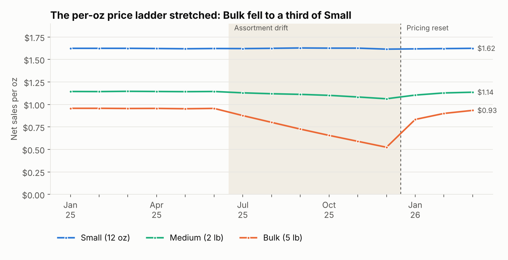
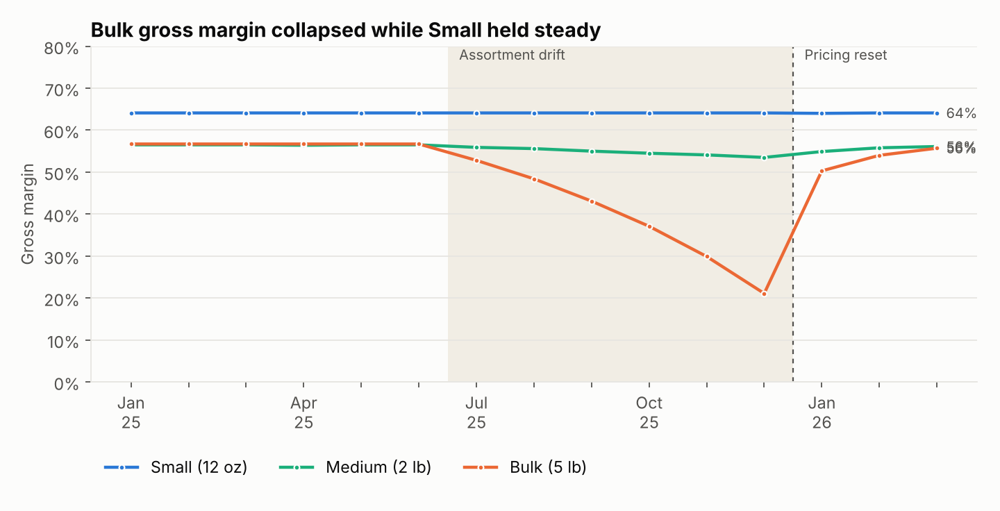
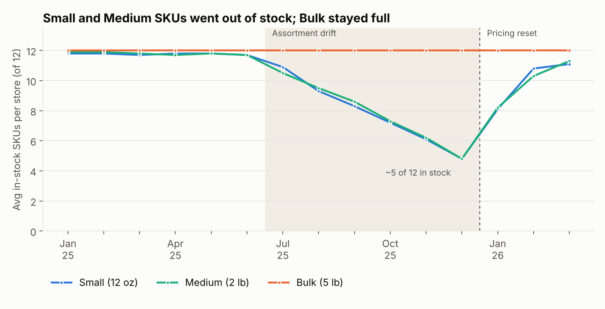
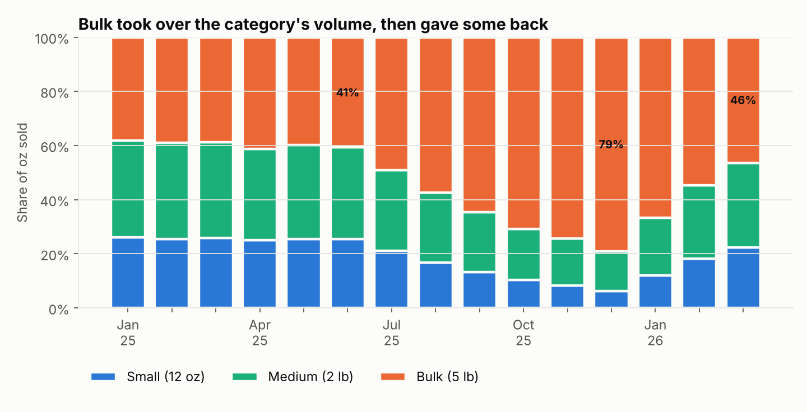

# Grounds for Concern
### When more volume meant less profit: a size-tier pricing and assortment EDA

> **Synthetic data.** Ridgeline Roasters is a fictional 6-store specialty coffee retailer. The dataset is generated in this repo, but it is modeled on a real pricing and assortment analysis I led in a regulated retail category, and it reproduces the same pattern.



---

## Executive summary

From July to December 2025, Ridgeline's whole-bean coffee category showed a puzzling pattern. Volume (ounces sold) climbed steadily, but revenue lagged far behind it and gross profit actually fell. Leadership needed to know whether this was a demand problem, a pricing problem, or something else.

I ran an end-to-end pricing and assortment analysis across three bag sizes: **Small (12 oz)**, **Medium (2 lb)** and **Bulk (5 lb)**. I looked at net sales, gross margin, discount rate, net sales per ounce and in-stock SKU depth for each size.

The analysis found that inventory buys had tilted toward Bulk bags. Small and Medium SKUs went out of stock while Bulk stayed fully stocked and was discounted harder each month. Customers were effectively trained to buy the cheapest cost-per-ounce option, which cannibalized the higher-margin smaller sizes.

| Metric (Jun → Dec 2025) | Change |
|---|---|
| Ounces sold | **+144%** |
| Net sales | +38% |
| Gross profit | **−18%** |
| Net sales per oz (category) | $1.19 → $0.67 (**−44%**) |
| Bulk gross margin | **57% → 21%** |
| Bulk discount rate | 5% → 38% |
| Small + Medium SKUs in stock per store | 23.4 → 9.6 (**−59%**) |
| Bulk share of ounces sold | 41% → 79% |

---

## The business problem

On the surface the category looked healthy, because units were moving. Underneath, every additional ounce was earning less, and the largest volume driver was quietly losing most of its margin. Leadership had no view into *why*. They needed a way to diagnose the root cause and correct course before the next planning cycle.

## Approach

1. **Frame the metric.** I replaced "units sold" with **net sales per ounce** and **gross margin by size tier** as the measures of business health.
2. **Decompose by size tier.** I split every monthly metric by Small, Medium and Bulk to see where margin was leaking.
3. **Check the shelf.** I joined weekly inventory snapshots to measure how many SKUs per size were actually available to buy.
4. **Test for cannibalization.** I compared each size's share of ounces sold across three windows: before the drift, during it, and after the reset.

## What the data revealed

**1. The per-oz price ladder stretched.** Small and Medium held their per-oz price. Bulk was list-cut and stacked with promos until it sold for about a third of Small's per-oz price.



**2. Bulk margin collapsed.** Bulk went from a 57% margin, in line with the rest of the category, to 21% by December. Small held at 64% throughout.



**3. The shelf pushed customers into Bulk.** By December, stores averaged about 5 of 12 Small and Medium SKUs in stock, while all 12 Bulk SKUs stayed full. Customers who wanted a smaller bag either found it gone or found Bulk cheaper per ounce.



**4. Volume migrated, not grew.** Bulk's share of ounces nearly doubled. The extra volume largely came from customers trading *into* the lowest-margin format, which is cannibalization rather than new demand.



## Recommendations

1. **Make net sales per ounce the north-star metric.** Volume is a vanity metric when margin is eroding. Evaluate pricing decisions on per-oz revenue and margin by size tier.
2. **Cap discounts on large formats.** Stacked Bulk promos were the single biggest driver of margin loss. Setting a discount cap per size tier protects margin while keeping Bulk competitive.
3. **Rebalance inventory to protect high-margin demand.** Restore Small and Medium availability so customers can choose, and trade up, instead of defaulting to Bulk.

## Impact (simulated reset, Jan–Mar 2026)

The dataset models those recommendations taking effect in January 2026:

- Category net sales per oz recovered to **$1.15** by March, close to the pre-drift $1.19.
- Bulk margin recovered to **56%**, and blended category margin returned to **58%** (from 35% in December).
- Bulk's share of ounces fell back to **46%**, with no more cross-size cannibalization.

---

## Repo layout

```
grounds-for-concern/
├── data/                  # generated CSVs + ridgeline.db (SQLite)
├── sql/eda_queries.sql    # monthly, by-tier, in-stock and mix-shift queries
├── src/
│   ├── generate_data.py   # builds the synthetic dataset (seeded, reproducible)
│   ├── load_db.py         # loads CSVs into SQLite and creates the EDA views
│   └── eda.py             # runs the analysis, renders charts, prints headline numbers
└── charts/                # PNG outputs used in this README
```

## Data model

| Table | Grain | Key columns |
|---|---|---|
| `stores` | store | store_id, region, traffic_index |
| `products` | SKU (12 origins × 3 sizes) | sku_id, size_oz, size_tier, base_list_price, unit_cost |
| `transactions` | order line (~115k rows) | order_date, store_id, sku_id, qty, gross_sales, discount_amt, net_sales, cogs |
| `inventory_snapshots` | store × SKU × week | week_start, on_hand_units |

## Run it

```bash
pip install -r requirements.txt
python src/generate_data.py   # ~1 min, seeded so results are reproducible
python src/eda.py             # builds the DB, renders charts, prints the numbers above
```

## Tools & methods

- **SQL** (SQLite; the views port directly to Snowflake or Postgres) for extraction and metric logic
- **Python** (pandas, NumPy, matplotlib) for data generation, analysis and charts
- **Key metrics:** net sales per oz, gross margin by tier, discount rate, in-stock SKU depth, size-mix share
